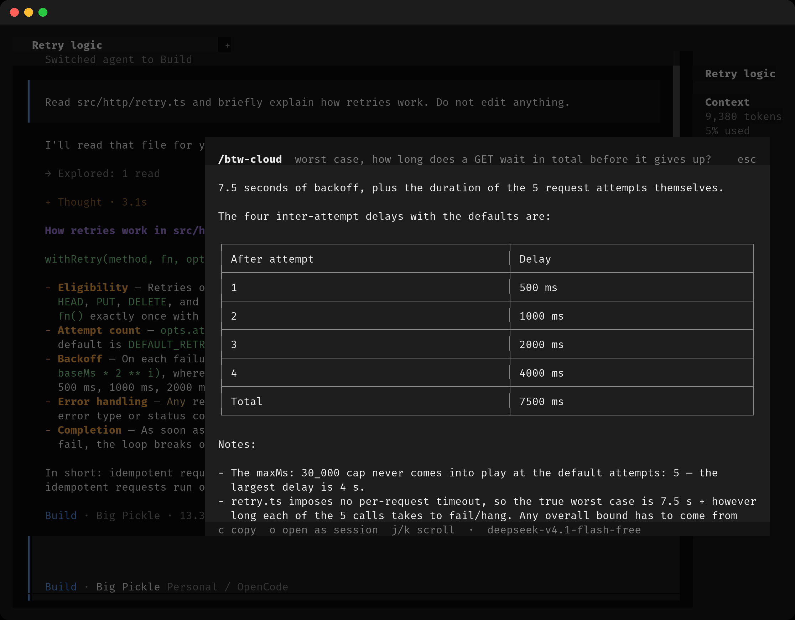

<p align="center">
  <picture>
    <source media="(prefers-color-scheme: dark)" srcset="docs/brand/logo-dark.svg">
    
  </picture>
</p>

<h3 align="center">Ask side questions without waiting on your local model.</h3>
<p align="center"><code>/btw</code> for <a href="https://opencode.ai">OpenCode</a>, answered by any model you choose: a fast cloud model, while your main session keeps running on llama.cpp, Ollama or LM Studio.</p>

<p align="center">
  <a href="#features">Features</a> · <a href="#install"><b>Install</b></a> ·
  <a href="#how-it-works">How it works</a> · <a href="#privacy">Privacy</a> ·
  <a href="#limitations">Limitations</a>
</p>

<p align="center">
  <a href="https://github.com/exie1122/opencode-btw-cloud/stargazers"></a>
  <a href="LICENSE"></a>
  
  
  <a href="https://github.com/exie1122/opencode-btw-cloud/commits/main"></a>
</p>

<p align="center">
  
</p>

**Free, open source, one command to install.** No API keys of its own, no telemetry. It uses the providers you already have in OpenCode.

```sh
opencode plugin add github:exie1122/opencode-btw-cloud
```

## Why

The built-in `/btw` answers with the *session's* model. When that model runs locally, a quick side question has to wait for your GPU to finish the current turn, and then competes with it. `/btw-cloud` answers the same kind of question from the same session context, using a model **you** pick from any provider OpenCode knows about. Your main session and your GPU are left alone.

## Features

- **`/btw-cloud <question>`** — one-shot answer in a floating popup, like `/btw`. Nothing is added to your conversation.
- **`/btw-cloud-model`** — searchable picker of every model OpenCode can use, grouped by provider. Your choice is remembered.
- **Full native context** — the answering model sees the real session history (messages, tool calls and results), not a lossy text summary.
- **Never blocks your local model** — your local server keeps generating; the side question runs elsewhere.
- **`o` to open as a session** — open a copy of the session on the side model and keep working there.
- `c` copies the answer (OSC 52), `j`/`k`/arrows/PgUp/PgDn scroll, `esc` closes.

## How it works

1. Fork the current session (OpenCode copies the history server-side; it takes milliseconds).
2. Switch the fork to your chosen model.
3. Run `session.generate` on the fork — the same one-shot, tool-free call the built-in `/btw` uses, with the same instruction.
4. Delete the fork and show the answer. Pressing `o` opens a *fresh* fork on the side model as a normal session.

Your main session, its model and its local KV cache are never modified. The temporary fork may flash in the session list for the second or two it exists. If OpenCode exits mid-question, the leftover fork is removed automatically the next time OpenCode starts.

## Requirements

- OpenCode **2.3** or newer (uses the v2 TUI plugin API).
- At least one provider for the side model — e.g. OpenCode's free models, or any API provider you've connected.

## Install

From GitHub:

```sh
opencode plugin add github:exie1122/opencode-btw-cloud
```

Or from a local clone — add it to the `plugins` list in `~/.config/opencode/cli.json`:

```jsonc
{
  "plugins": ["file:///absolute/path/to/opencode-btw-cloud"]
}
```

To get updates later: `opencode plugin update`.

Restart OpenCode, then run `/btw-cloud-model` once to choose a model (or just run `/btw-cloud` — it asks the first time).

### Set a default model in config (optional)

If you'd rather not use the picker, pass the model as a plugin option:

```jsonc
{
  "plugins": [
    { "package": "github:exie1122/opencode-btw-cloud", "options": { "model": "opencode/deepseek-v4.1-flash-free" } }
  ]
}
```

A model chosen with `/btw-cloud-model` takes precedence over the option.

## Privacy

`/btw-cloud` sends your session's context (the same content your main model sees) to the model you select. If you chose a cloud model, that content leaves your machine for that provider — just like OpenCode's compaction does when it's configured with a cloud model. If you need everything to stay local, pick a local model or use the built-in `/btw`.

The plugin itself stores only one setting (your chosen model ID) in OpenCode's local state directory. It has no telemetry, no network calls of its own, and no credentials — all requests go through your OpenCode server using the providers you've already configured.

## Limitations

- Relies on OpenCode's v2 plugin API and the `session.fork` / `session.switchModel` / `session.generate` endpoints; a future OpenCode release could change them.
- Code blocks in answers get basic styling rather than full theme syntax highlighting.
- A session opened with `o` contains the history up to the side question; the side question and answer themselves are not added to it.
- Clipboard copy needs a terminal with OSC 52 support.

## Uninstall

```sh
opencode plugin remove opencode-btw-cloud
```

(or delete the entry from `cli.json`).

## License

[MIT](LICENSE)
